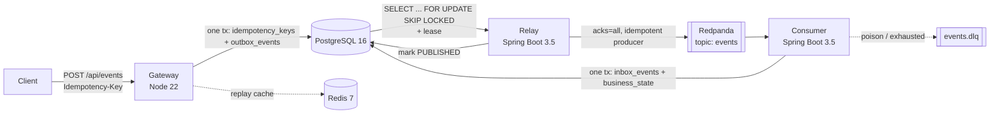

# execute-once

[](https://github.com/Husqvarnalox/execute-once/actions/workflows/ci.yml)
[](LICENSE)


Exactly-once business effect over at-least-once delivery, built from first principles and verified under load.

A client sends a request with an `Idempotency-Key`. The request is accepted once, published through a transactional
outbox to Kafka, and applied once to business state through an inbox table, no matter how many times the client
retries, the relay restarts or Kafka redelivers. Every link in that chain is a small, explicit piece of code with a
test that breaks it on purpose.

## Why this exists

Kafka's idempotent producer and `acks=all` prevent duplicates inside one producer session. They say nothing about the
gap between a database commit and a publish, a relay that dies after publishing but before recording it, or a consumer
that crashes after writing but before committing its offset. "Exactly once" between a database and a business effect
is not a flag; it is at-least-once delivery plus deduplication at the point of effect, with the deduplication record and
the effect in the same transaction.

This repository makes that chain explicit, documents each decision in an [ADR](docs/adr/README.md), and ships the
tooling to prove the invariants hold: Testcontainers tests per service and a load generator that verifies the database
after every run.

## Architecture



| Component | Role | Key guarantee |
|---|---|---|
| [`services/gateway-node`](services/gateway-node) | HTTP intake. Locks the idempotency row, writes the outbox event and the stored response in one transaction. | A `202` means a durable event exists. Same key + same payload replays; same key + different payload is `409`. |
| [`services/relay-java`](services/relay-java) | Polls `outbox_events` with `SKIP LOCKED`, leases rows, publishes, retries with capped jittered backoff, prunes old rows. | At-least-once publication; a crash mid-batch is recovered by lease expiry, never by an operator. |
| [`services/consumer-java`](services/consumer-java) | Manual-ack listener. Inserts into `inbox_events` (PK = `event_id`) and applies the effect in the same transaction. | Exactly-once effect. Duplicates are recorded, poison records are dead-lettered with a terminal row. |
| [`scripts/python-bench`](scripts/python-bench) | Load generator with unique, duplicate-heavy and burst profiles, then verifies invariants directly in Postgres. | The same tool runs in CI and produced the numbers in [`docs/results.md`](docs/results.md). |

The full data flow, state machines and table layout are in [`docs/architecture.md`](docs/architecture.md).

## Quick start

Requires Docker with Compose v2. The first build takes a few minutes (Maven and npm caches are cold).

```bash
make up
```

```bash
curl -i -X POST http://localhost:3000/api/events \
  -H 'Idempotency-Key: demo-1' \
  -H 'Content-Type: application/json' \
  -d '{"amount": 10, "note": "demo"}'
```

Run the same command again and you get the same `event_id` with `Idempotency-Replayed: true`. Change the amount and
you get `409`. Watch the event travel:

```bash
curl -s http://localhost:3000/api/events/<event_id> | jq
```

`status` moves `pending` → `published` → `applied`. Then prove nothing was duplicated:

```bash
make e2e
```

That starts the stack, sends 500 requests of which 30% reuse an earlier key, waits for every event to reach
`business_state`, and checks the invariants (no duplicate effects, no lost events, no stuck rows, one outbox row per
key). It exits non-zero if any of them fail. `make down` tears everything down. If the default host ports are taken,
override them: `POSTGRES_PORT=15432 REDIS_PORT=16379 make up`.

Measured on a laptop with the default configuration (details in [`docs/results.md`](docs/results.md)):

| Profile | Requests | Gateway p99 | Accept → applied p95 | Duplicate effects | Lost |
|---|---|---|---|---|---|
| 30% duplicate keys, 50 concurrent | 1000 | 37 ms | 0.63 s | 0 | 0 |
| unique keys, 200 concurrent | 2000 | 95 ms | 2.4 s | 0 | 0 |
| unique keys, relay killed mid-run | 3000 | 162 ms | 9.3 s | 0 | 0 |

## How the guarantee is built

1. **Intake** (ADR [0003](docs/adr/0003-idempotency-key-lock-and-hash.md)). `INSERT ... ON CONFLICT DO NOTHING`
   followed by `SELECT ... FOR UPDATE` on the key row. Two concurrent first-time requests serialize on the row lock
   instead of racing; the loser wakes up and replays the winner's response. The request hash is computed over
   canonical JSON, so key order does not matter.
2. **Outbox** (ADR [0001](docs/adr/0001-transactional-outbox.md)). The event row and the `COMPLETED` response commit
   atomically with the idempotency row. There is no code path that returns `202` without a committed outbox row.
3. **Relay** (ADR [0004](docs/adr/0004-lease-based-claiming.md)). Rows are claimed with `FOR UPDATE SKIP LOCKED` and
   leased by pushing `next_attempt_at` forward, in a transaction that does not touch Kafka. The publish happens outside
   any transaction. A relay that dies after publishing but before marking `PUBLISHED` leaves a row whose lease expires,
   so the event is published again and deduplicated downstream.
4. **Consumer** (ADR [0002](docs/adr/0002-inbox-dedup-at-point-of-effect.md)). The inbox insert and the business write
   share one transaction; the offset is acknowledged only after commit. A redelivered `event_id` violates the inbox
   primary key and is recorded as `DUPLICATE`. Malformed records go to `events.dlq` on the first attempt
   (ADR [0006](docs/adr/0006-dead-letter-topic.md)); transient failures are retried with backoff first.
5. **Redis** (ADR [0005](docs/adr/0005-redis-fails-open.md)) is a replay cache and an advisory rate limiter. Every
   Redis failure fails open and fails fast; the integration tests run the intake path with Redis stopped.

## Failure scenarios

Each row is exercised by an automated test or by the e2e job; the manual drills in
[`docs/experiments.md`](docs/experiments.md) reproduce them against the running stack.

| Scenario | Outcome | Covered by |
|---|---|---|
| Client retries the same key, serially or in parallel | Same `event_id`, one outbox row | gateway integration test (20 parallel requests) |
| Same key, different payload | `409 idempotency_key_conflict` | gateway unit + integration tests |
| Same payload, different key order | Replay, not conflict | gateway unit + integration tests |
| Redis unavailable | Intake served from Postgres, limiters allow traffic | gateway integration test |
| Relay crashes after publish, before status update | Republished after lease expiry; inbox absorbs the duplicate | consumer integration test (duplicate record) |
| Kafka unavailable | Rows back off with jitter up to `relay.max-attempts`, then `FAILED` with a metric | relay unit tests, manual drill |
| Consumer crash before ack | Redelivered and deduplicated | consumer integration test |
| Malformed record (bad key, bad JSON, no amount) | Dead-lettered immediately, `DEAD_LETTERED` row written | consumer integration test |
| Transient DB failure in consumer | Retried with backoff, then dead-lettered | consumer error handler configuration |
| 30% duplicate keys at 50 concurrent requests | Zero duplicate effects, zero lost events | `make e2e` / CI |

## Operations

**Metrics.** Prometheus text format at `gateway:3000/metrics`, `relay:8080/actuator/prometheus` and
`consumer:8080/actuator/prometheus` (mapped to host ports 3000, 8081 and 8082 by Compose).

| Signal | Metric | Alert when |
|---|---|---|
| Outbox backlog | `outbox_relay_backlog` | grows for longer than the lease |
| Terminal publish failures | `outbox_relay_failed_total{terminal="true"}` | > 0 |
| Dead-lettered records | `inbox_dead_lettered_total` | > 0 |
| Duplicate rate | `inbox_duplicate_total` / `inbox_applied_total` | spikes without a client retry storm |
| Replay rate | `idempotency_replays_total{source}` | `source="postgres"` dominates (Redis cache not working) |
| Conflicts | `idempotency_conflicts_total` | > 0 (clients reusing keys incorrectly) |

**Health.** `GET /health` and `GET /ready` on the gateway; `/actuator/health/liveness` and `/readiness` on the Java
services. All three containers have Docker health checks and Compose waits on them.

**Retention.** The relay deletes `PUBLISHED` outbox rows and idempotency keys older than `relay.retention` (7 days by
default). A retry after that window is a new request; that window is the idempotency contract.

**Dead letters.** `events.dlq` holds records the consumer gave up on, with the original headers plus the exception.
There is no automatic replay; inspect with `rpk topic consume events.dlq` inside the `redpanda` container.

## Configuration

Gateway (environment variables):

| Variable | Default | Purpose |
|---|---|---|
| `PORT` | `3000` | HTTP port |
| `PGHOST`, `PGPORT`, `PGUSER`, `PGPASSWORD`, `PGDATABASE` | `127.0.0.1`, `5432`, `app`, `app`, `app` | Postgres connection |
| `PGPOOL_MAX` | `20` | Connection pool size; also bounds concurrent waiters on one idempotency key |
| `REDIS_URL` | `redis://127.0.0.1:6379` | Replay cache |
| `IDEM_TTL_SECONDS` | `3600` | Redis cache TTL for stored responses |
| `BODY_LIMIT` | `16kb` | Maximum request body |
| `SHUTDOWN_TIMEOUT_MS` | `10000` | Grace period for in-flight requests on SIGTERM |
| `LOG_LEVEL` | `info` | pino level |

Relay and consumer (`application.yml`, overridable through `RELAY_*` / `CONSUMER_*` environment variables in Spring's
relaxed binding, plus `DB_URL`, `DB_USER`, `DB_PASSWORD`, `KAFKA_BOOTSTRAP`, `REDIS_URL`):

| Property | Default | Purpose |
|---|---|---|
| `relay.poll-interval` | `1s` | Outbox poll delay |
| `relay.batch-size` | `200` | Rows claimed per batch; a poll keeps claiming batches until the outbox is drained |
| `relay.lease` | `15s` | How long a claimed row is invisible to other relays |
| `relay.base-backoff` / `relay.max-backoff` | `500ms` / `60s` | Exponential backoff with full jitter |
| `relay.max-attempts` | `10` | After this the row is `FAILED` |
| `relay.rate-limit-per-second` | `1000` | Redis fixed window; `0` disables |
| `relay.retention` / `relay.cleanup-interval` | `168h` / `10m` | Pruning of published rows and old keys |
| `consumer.concurrency` | `3` | Listener threads |
| `consumer.max-retries` / `consumer.retry-backoff` | `5` / `500ms` | Retries before dead-lettering |
| `consumer.dead-letter-topic` | `events.dlq` | Where poison and exhausted records go |
| `consumer.rate-limit-per-second` | `1000` | Redis fixed window; `0` disables |

## Development

```bash
make lint   # eslint + prettier, spotless (google-java-format), ruff
make test   # unit + Testcontainers integration tests (needs Docker)
make e2e    # full stack + load + invariant verification
```

CI runs the same targets on every push: gateway, relay and consumer each in their own job, plus the e2e job against the
Compose stack. Tagged releases build multi-arch images to GHCR. See [CONTRIBUTING.md](CONTRIBUTING.md).

## Limitations and non-goals

- One topic, one event type, and a deliberately small business effect. The point is the delivery chain, not the
  domain.
- Ordering is not guaranteed. Events are keyed by `event_id`; nothing depends on sequence.
- The rate limiters are global fixed windows: a backpressure knob, not fairness or protection.
- No authentication, no TLS, no multi-tenant isolation. See [SECURITY.md](SECURITY.md).
- Single-broker Redpanda and single Postgres in Compose; the design does not depend on that, but failover is not
  tested here.
- `inbox_events` is not pruned. A production deployment would remove rows older than the maximum redelivery window.

## License

Apache-2.0. See [LICENSE](LICENSE).
