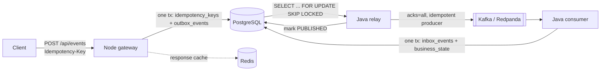

# execute-once

[](https://github.com/Husqvarnalox/execute-once/actions/workflows/ci.yml)
[](LICENSE)

A reference implementation of idempotent, end-to-end event processing across Node.js, PostgreSQL, Kafka-compatible
messaging (Redpanda) and Java. Requests are accepted once per `Idempotency-Key`, published through a transactional
outbox, and applied exactly once to business state through an inbox table — even when delivery is retried or duplicated.

## Why

Kafka's idempotent producer and `acks=all` prevent duplicates *inside* a producer session, not across a database write,
a relay restart and a consumer retry. Real "exactly once" between a database and a business effect is built from
at-least-once delivery plus deduplication at the point of effect. This project makes that chain explicit and
testable.

The guarantee it targets: **exactly-once business effect under at-least-once delivery**, assuming Postgres is the
source of truth and the consumer applies effects only inside the same transaction that records the inbox row.

## Architecture



| Component | Role |
|---|---|
| `services/gateway-node` | HTTP intake. Locks the idempotency row, writes the outbox event and the stored response in a single transaction. Redis is a replay cache only. |
| `services/relay-java` | Polls `outbox_events` with `SKIP LOCKED`, leases rows, publishes to Kafka, retries with exponential backoff and jitter, records attempts. |
| `services/consumer-java` | Manual-ack Kafka consumer. Inserts into `inbox_events` (primary key = `event_id`) and applies the effect in the same transaction; duplicates hit the unique key and are skipped. |
| `scripts/python-bench` | Load generator with unique-key and duplicate-key profiles. |

## Quick start

Requires Docker with Compose.

```bash
docker compose up -d --build

curl -i -X POST http://localhost:3000/api/events \
  -H 'Idempotency-Key: demo-1' \
  -H 'Content-Type: application/json' \
  -d '{"amount":10,"note":"demo"}'

# Repeat the same command: same event_id, no second outbox row.
docker compose exec postgres psql -U app -c "select * from business_state"
```

Tear down with `docker compose down -v`. The credentials in `docker-compose.yml` are for local development only.

## How it works

1. **Intake.** The gateway inserts the idempotency row (`ON CONFLICT DO NOTHING`), then `SELECT ... FOR UPDATE`. A
   concurrent request with the same key waits on that lock and then replays the stored response. The same key with a
   different payload hash returns `409`.
2. **Outbox.** The event row and the `COMPLETED` response are committed atomically with the idempotency row, so a `202`
   implies a durable event.
3. **Relay.** Rows are claimed in a transaction and leased by pushing `next_attempt_at` 15 s ahead. If the relay
   crashes after publishing but before marking `PUBLISHED`, the lease expires and the event is published again —
   the duplicate is absorbed downstream.
4. **Consumer.** Offsets are acknowledged only after the database transaction commits. A redelivered `event_id` fails
   the `inbox_events` insert and is recorded as `DUPLICATE`.

Details and invariants: [docs/architecture.md](docs/architecture.md). Failure scenarios and verification SQL:
[docs/experiments.md](docs/experiments.md).

## Failure scenarios covered by design

| Scenario | Outcome |
|---|---|
| Client retries the same `Idempotency-Key` | Same response, one outbox row |
| Same key, different payload | `409` |
| Relay crashes after publish, before status update | Event republished after lease expiry; inbox deduplicates |
| Duplicate Kafka delivery / consumer crash before ack | Redelivered; inbox deduplicates |
| Redis unavailable | Gateway falls back to Postgres; rate limiters fail open |
| Kafka unavailable | Outbox rows back off and retry up to `max-attempts`, then `FAILED` |

These are specified by the design and exercised manually using the steps in `docs/experiments.md`; there is no
automated failure-injection suite yet.

## Load profiles

```bash
docker compose run --rm bench python run.py --profile normal --total 200
docker compose run --rm bench python run.py --profile dup30 --total 500
```

`dup30` repeats 30% of idempotency keys. After a run, check the invariants with the SQL in
[docs/experiments.md](docs/experiments.md). Result tables in [docs/results.md](docs/results.md) are intentionally empty;
no benchmark numbers are published.

## Configuration

Environment variables (see `docker-compose.yml` and each service's `application.yml`):

| Variable | Used by | Default |
|---|---|---|
| `PGHOST`, `PGPORT`, `PGUSER`, `PGPASSWORD`, `PGDATABASE` | gateway | `127.0.0.1:5432`, `app`/`app` |
| `REDIS_URL` | all | `redis://127.0.0.1:6379` |
| `IDEM_TTL_SECONDS`, `IDEM_PROGRESS_TTL_SECONDS` | gateway | `3600`, `30` |
| `DB_URL`, `DB_USER`, `DB_PASSWORD` | relay, consumer | local Postgres |
| `KAFKA_BOOTSTRAP` | relay, consumer | `localhost:9092` |

Relay and consumer tuning (`batch-size`, `max-attempts`, `rate-limit-per-second`, ...) lives in `application.yml`.

## Testing

CI builds both Java services, syntax-checks the gateway and bench script, and validates the Compose file. There are no
unit or integration tests yet; correctness is checked through the load profiles and invariant queries above.

## Limitations

- Consumer errors are retried by Spring Kafka's default error handler (bounded), after which the record is skipped and
  logged. There is no dead-letter topic, so a persistently failing record can be dropped from the consumer's view.
- The consumer's `consumer_attempts` table records outcomes but there is no terminal `FAILED` state for events.
- Rate limiting is a global fixed-window counter in Redis, not per tenant.
- One Kafka topic, one event type, and a demo business effect (`business_state`).
- No authentication on the gateway; no graceful shutdown in the Java services; no TLS.
- Single-node Redpanda and Postgres; no multi-broker or failover testing.

## Roadmap

Automated failure-injection tests, a dead-letter topic, per-tenant rate limits, outbox cleanup, and published
benchmark results.

## License

Apache-2.0. See [LICENSE](LICENSE).
